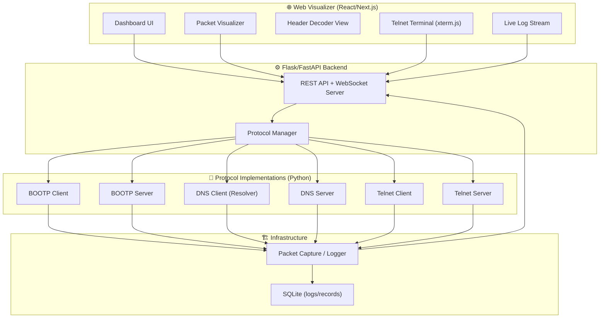
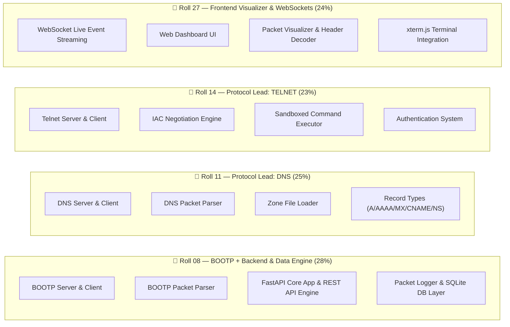

# 🖧 Group 3 — Mini Group Project: Full Implementation Plan

## Protocols: **BOOTP** (Network) · **DNS** (Transport) · **TELNET** (Application)

**Team:** Roll 08, Roll 11, Roll 14, Roll 27
**Deadline:** 16–20 November 2026

---

## 1. Project Overview

We must **implement** (not just simulate) three protocols using **raw TCP/UDP sockets** in Python:

| Protocol | Layer | Transport | RFC |
|----------|-------|-----------|-----|
| **BOOTP** | Network | UDP (client→67, server→68) | RFC 951 |
| **DNS** | Transport | UDP port 53 (+ TCP fallback) | RFC 1035 |
| **TELNET** | Application | TCP port 23 | RFC 854 |

We will also build a **live web-based visualizer** to demonstrate packet flow, protocol headers, and interactions — giving us a massive edge in presentation.

---

## 2. High-Level Architecture



---

## 3. Detailed Protocol Implementation Plans

### 3.1 BOOTP (Bootstrap Protocol)

> [!IMPORTANT]
> BOOTP is the predecessor to DHCP. We implement a **BOOTP server** that responds to client boot requests with an IP assignment from a configured pool.

**Implementation details:**

| Component | Description |
|-----------|-------------|
| **BOOTP Server** | Listens on UDP port 67. Maintains an IP pool (e.g., `192.168.1.100–200`). Receives `BOOTREQUEST`, looks up MAC→IP mapping (static table), returns `BOOTREPLY` with assigned IP, server IP, gateway, and optional boot file. |
| **BOOTP Client** | Sends `BOOTREQUEST` broadcast on UDP port 68. Parses `BOOTREPLY` to extract assigned IP, server info. |
| **Packet Format** | 300-byte fixed structure: `op(1) htype(1) hlen(1) hops(1) xid(4) secs(2) flags(2) ciaddr(4) yiaddr(4) siaddr(4) giaddr(4) chaddr(16) sname(64) file(128) vend(64)` |

**Key features to implement:**
- MAC-to-IP static mapping table (editable via UI)
- Transaction ID (`xid`) matching
- Broadcast handling
- Vendor-specific extensions area
- Visual display of all 14 header fields in the UI

---

### 3.2 DNS (Domain Name System)

> [!IMPORTANT]
> We build both a **DNS resolver (client)** and a **DNS server** that can answer queries for a local zone and forward unknown queries.

**Implementation details:**

| Component | Description |
|-----------|-------------|
| **DNS Server** | Listens on UDP port 53. Loads zone file (A, AAAA, CNAME, MX, NS records). Answers authoritatively for local zone; returns NXDOMAIN or forwards otherwise. |
| **DNS Client** | Constructs DNS query packets (QTYPE: A, AAAA, MX, CNAME, NS). Sends to our server, parses response. |
| **Packet Format** | Header (12 bytes): `ID(2) Flags(2) QDCOUNT(2) ANCOUNT(2) NSCOUNT(2) ARCOUNT(2)` + Question + Answer + Authority + Additional sections. |

**Key features to implement:**
- DNS message compression (label pointers)
- Multiple record types: A, AAAA, CNAME, MX, NS
- Recursive query flag handling
- Editable zone file via UI
- Query/response visualization with full header decode
- Response time measurement

---

### 3.3 TELNET

> [!IMPORTANT]
> We build a **Telnet server** that provides a remote shell, and a **Telnet client** — plus a web-based terminal via `xterm.js`.

**Implementation details:**

| Component | Description |
|-----------|-------------|
| **Telnet Server** | Listens on TCP port 2323 (non-privileged). Authenticates user (simple user/pass). Spawns a pseudo-shell or command executor. Handles Telnet option negotiation (WILL/WONT/DO/DONT). |
| **Telnet Client** | Connects to server, performs option negotiation, sends commands, receives output. |
| **Option Negotiation** | IAC (0xFF) command sequences: WILL/WONT/DO/DONT for ECHO, SGA (Suppress Go Ahead), NAWS (window size). |

**Key features to implement:**
- IAC command parsing and negotiation
- Simple authentication (username/password)
- Command execution on server side (sandboxed subset: `ls`, `pwd`, `echo`, `date`, `whoami`, `cat`)
- Web terminal using xterm.js connected via WebSocket
- Session logging with full IAC decode in visualizer

---

## 4. Web Visualizer — The Killer Feature 🚀

This is what will set our project apart. A **single-page web app** with these views:

### 4.1 Dashboard
- Protocol status cards (BOOTP server status, DNS server status, Telnet server status)
- Quick-launch buttons to trigger client operations
- Live stats (packets sent/received, active sessions)

### 4.2 Packet Flow Visualizer
- **Sequence diagram** rendered in real-time showing client ↔ server message exchange
- Color-coded by protocol (BOOTP=blue, DNS=green, Telnet=orange)
- Click any packet to drill into header details

### 4.3 Header Decoder
- Bit-level breakdown of each protocol's packet headers
- Interactive: hover over a field to see its meaning, value, and RFC reference
- Side-by-side raw hex dump + decoded view

### 4.4 Telnet Terminal
- Embedded `xterm.js` terminal connected to our Telnet server via WebSocket bridge
- Shows IAC negotiations in a side panel in real-time

### 4.5 DNS Query Tool
- Input box to type a domain name
- Dropdown for record type (A, AAAA, MX, CNAME, NS)
- Shows query construction → wire format → response parsing step by step

### 4.6 BOOTP Simulator
- Button to trigger a boot request
- Shows the full BOOTREQUEST → BOOTREPLY exchange
- Visual IP pool showing allocated vs. free addresses

---

## 5. Technology Stack

| Layer | Technology | Rationale |
|-------|-----------|-----------|
| Protocol implementations | **Python 3.10+** with `socket`, `struct`, `threading` | Clean, readable, easy to demo |
| Backend/API | **FastAPI** + **WebSockets** | Async, fast, auto-docs, WebSocket native |
| Frontend | **React** (Vite) or **plain HTML/JS** | If time is short, plain HTML+JS works fine |
| Terminal | **xterm.js** | Industry-standard web terminal |
| Packet visualization | **D3.js** or **Mermaid.js** (dynamic) | Beautiful diagrams |
| Database | **SQLite** | Zero-config, stores logs |
| Styling | **Tailwind CSS** | Fast, responsive UI |

> [!TIP]
> If React feels too heavy for the timeline, a **single HTML file** with vanilla JS + Tailwind CDN + WebSocket is totally viable and still looks great.

---

## 6. Project Structure

```
group-project/
├── README.md
├── requirements.txt
├── run.py                      # Single entry point to start everything
│
├── protocols/
│   ├── __init__.py
│   ├── bootp/
│   │   ├── __init__.py
│   │   ├── server.py           # BOOTP server implementation
│   │   ├── client.py           # BOOTP client implementation
│   │   ├── packet.py           # BOOTP packet builder/parser
│   │   └── config.py           # IP pool, MAC mappings
│   ├── dns/
│   │   ├── __init__.py
│   │   ├── server.py           # DNS server implementation
│   │   ├── client.py           # DNS resolver/client
│   │   ├── packet.py           # DNS message builder/parser
│   │   ├── zone.py             # Zone file loader
│   │   └── records.py          # DNS record types
│   └── telnet/
│       ├── __init__.py
│       ├── server.py           # Telnet server implementation
│       ├── client.py           # Telnet client implementation
│       ├── negotiation.py      # IAC option negotiation handler
│       └── commands.py         # Sandboxed command executor
│
├── backend/
│   ├── __init__.py
│   ├── app.py                  # FastAPI application
│   ├── websocket.py            # WebSocket handlers
│   ├── routes/
│   │   ├── bootp_routes.py
│   │   ├── dns_routes.py
│   │   └── telnet_routes.py
│   └── models.py               # Pydantic models
│
├── frontend/
│   ├── index.html              # Main dashboard
│   ├── css/
│   │   └── styles.css
│   ├── js/
│   │   ├── app.js              # Main app logic
│   │   ├── packet-visualizer.js
│   │   ├── header-decoder.js
│   │   ├── terminal.js         # xterm.js integration
│   │   ├── dns-tool.js
│   │   └── bootp-simulator.js
│   └── assets/
│
├── logger/
│   ├── __init__.py
│   ├── packet_logger.py        # Captures and logs all packets
│   └── db.py                   # SQLite operations
│
├── tests/
│   ├── test_bootp.py
│   ├── test_dns.py
│   └── test_telnet.py
│
├── docs/
│   ├── BOOTP.md                # Protocol documentation
│   ├── DNS.md
│   ├── TELNET.md
│   └── architecture.md
│
└── data/
    ├── zone.txt                # DNS zone file
    ├── bootp_pool.json         # BOOTP IP pool config
    └── users.json              # Telnet user credentials
```

---

## 7. Work Division — 4 Members



### Detailed Task Breakdown

#### 🧑 Roll 08 — BOOTP + Backend & Data Engine (Days 1–10)

| Day | Task | Deliverable |
|-----|------|-------------|
| 1–2 | Study RFC 951, understand BOOTP packet format & initialize FastAPI architecture | Notes + packet struct diagram + app skeleton |
| 3–4 | Implement `packet.py` (build/parse BOOTP messages) + DB schema setup | Working BOOTP packet encoder/decoder + SQLite models |
| 5–6 | Implement `server.py` (UDP listener, IP pool management) + REST endpoints for BOOTP | Server that replies to requests + working BOOTP API routes |
| 7 | Implement `client.py` (send BOOTREQUEST, parse BOOTREPLY) & protocol control APIs | Working client-server exchange + protocol start/stop APIs |
| 8 | Build `packet_logger.py` + SQLite persistence + centralized REST API routing | Global packet capture pipeline & query endpoints ready |
| 9 | Write tests (`test_bootp.py`), swagger API validation & backend-to-protocol bindings | All backend endpoints passing and documented |
| 10 | Documentation (`BOOTP.md`, `architecture.md`) + backend stabilization | Complete backend docs & rock-solid API layer |

#### 🧑 Roll 11 — DNS (Days 1–10)

| Day | Task | Deliverable |
|-----|------|-------------|
| 1–2 | Study RFC 1035, understand DNS message format | Notes + message struct diagram |
| 3–4 | Implement `packet.py` (DNS message builder/parser with compression) | Working encoder/decoder |
| 5 | Implement `zone.py` + `records.py` (zone file parsing, record types) | Zone file loaded and queryable |
| 6–7 | Implement `server.py` (UDP listener, query matching, response) | Server answering queries |
| 8 | Implement `client.py` (build query, send, parse response) | Full DNS resolution working |
| 9 | Write tests + integrate with backend API | `test_dns.py` passing |
| 10 | Documentation + help Roll 27 with DNS UI | `DNS.md` complete |

#### 🧑 Roll 14 — TELNET (Days 1–10)

| Day | Task | Deliverable |
|-----|------|-------------|
| 1–2 | Study RFC 854, understand Telnet protocol + IAC commands | Notes + IAC command table |
| 3–4 | Implement `negotiation.py` (IAC parser, WILL/WONT/DO/DONT state machine) | Working negotiation engine |
| 5–6 | Implement `server.py` (TCP listener, session management, auth) | Server accepting connections |
| 7 | Implement `commands.py` (sandboxed command executor) | Safe command execution |
| 8 | Implement `client.py` (connect, negotiate, send/receive) | Full Telnet session working |
| 9 | Write tests + integrate with backend API | `test_telnet.py` passing |
| 10 | Documentation + help Roll 27 with Telnet UI | `TELNET.md` complete |

#### 🧑 Roll 27 — Frontend Visualizer & WebSockets (Days 1–10)

| Day | Task | Deliverable |
|-----|------|-------------|
| 1–2 | Set up frontend framework/structure & WebSocket client architecture | Frontend skeleton & WS connection ready |
| 3–4 | Build Dashboard UI (protocol status, controls) | Main page with protocol cards |
| 5–6 | Build Packet Visualizer (sequence diagrams, live updates via WS) | Real-time packet flow view |
| 7 | Build Header Decoder (bit-level breakdown, hex dump) | Interactive header explorer |
| 8 | Integrate xterm.js for Telnet web terminal | Working web terminal |
| 9 | Build DNS Query Tool + BOOTP Simulator UI panels | Interactive demo tools |
| 10 | Polish UI, responsive design, final visual integration | Production-ready visualizer |

---

## 8. Integration Timeline

```mermaid
flowchart LR
    subgraph Phase1["Phase 1: Foundation (Days 1-4)"]
        P1A["RFC Study + Design"]
        P1B["Packet Parsers"]
        P1C["Backend Skeleton"]
    end

    subgraph Phase2["Phase 2: Core (Days 5-7)"]
        P2A["Server Implementations"]
        P2B["Client Implementations"]
        P2C["UI Components"]
    end

    subgraph Phase3["Phase 3: Integration (Days 8-9)"]
        P3A["API Integration"]
        P3B["WebSocket Streams"]
        P3C["Testing"]
    end

    subgraph Phase4["Phase 4: Polish (Day 10)"]
        P4A["Documentation"]
        P4B["Demo Prep"]
        P4C["UI Polish"]
    end

    Phase1 --> Phase2 --> Phase3 --> Phase4
```



---

## 9. API Design

### REST Endpoints

```
# BOOTP
POST   /api/bootp/start-server        # Start BOOTP server
POST   /api/bootp/stop-server         # Stop BOOTP server
POST   /api/bootp/send-request        # Trigger a BOOTREQUEST
GET    /api/bootp/pool                # Get IP pool status
GET    /api/bootp/logs                # Get BOOTP packet logs

# DNS
POST   /api/dns/start-server          # Start DNS server
POST   /api/dns/stop-server           # Stop DNS server
POST   /api/dns/query                 # Send a DNS query { domain, type }
GET    /api/dns/zone                  # Get zone records
PUT    /api/dns/zone                  # Update zone records
GET    /api/dns/logs                  # Get DNS packet logs

# TELNET
POST   /api/telnet/start-server       # Start Telnet server
POST   /api/telnet/stop-server        # Stop Telnet server
GET    /api/telnet/sessions           # List active sessions
GET    /api/telnet/logs               # Get Telnet logs

# General
GET    /api/status                    # All protocol statuses
GET    /api/packets                   # All captured packets
WS     /ws/packets                    # Live packet stream
WS     /ws/telnet                     # Telnet terminal stream
```

---

## 10. Demo Script (Presentation Flow)

1. **Open Dashboard** → Show all three servers stopped
2. **Start BOOTP Server** → Show IP pool visualization
3. **Trigger BOOTP Client** → Watch BOOTREQUEST → BOOTREPLY in packet visualizer, drill into header decoder
4. **Start DNS Server** → Show zone file with records
5. **Query DNS** → Type `example.local` → Watch query construction → wire format → response parsing
6. **Query different record types** → MX, CNAME, NS
7. **Start Telnet Server** → Show it listening
8. **Open Web Terminal** → Login, run commands, show IAC negotiations in side panel
9. **Show Packet Log** → All captured packets with timestamps, sizes, protocol colors
10. **Show Header Decoder** → Click any packet, see bit-level breakdown

---

## 11. Bonus Features (If Time Permits)

| Feature | Impact | Effort |
|---------|--------|--------|
| 🎨 Dark/Light theme toggle | Presentation polish | Low |
| 📊 Packet statistics charts (D3.js) | Impressive visuals | Medium |
| 🔄 DNS recursive resolution (forward to 8.8.8.8) | Shows real-world behavior | Low |
| 📝 Export packet capture as `.pcap` | Professional touch | Medium |
| 🎥 Record & replay sessions | Great for demo | High |
| 🐳 Docker Compose setup | Easy deployment | Low |

---

## 12. Key Technical Decisions

> [!NOTE]
> **Why Python?** Socket programming in Python is clean and readable. `struct.pack/unpack` makes binary protocol work straightforward. Professors can read the code easily during evaluation.

> [!NOTE]
> **Why FastAPI over Flask?** Native async support, built-in WebSocket handling, automatic OpenAPI docs. Perfect for real-time packet streaming.

> [!WARNING]
> **Port Permissions:** Ports below 1024 require root. Use **non-privileged ports** during development:
> - BOOTP: 10067/10068 (instead of 67/68)
> - DNS: 10053 (instead of 53)
> - Telnet: 2323 (instead of 23)

> [!CAUTION]
> **Security:** The Telnet server executes commands. **Sandbox it strictly** — only allow whitelisted commands (`ls`, `pwd`, `echo`, `date`, `whoami`, `cat`). Never allow `rm`, `sudo`, or shell pipes.

---

## 13. Dependencies

```txt
# requirements.txt
fastapi>=0.104.0
uvicorn[standard]>=0.24.0
websockets>=12.0
pydantic>=2.5.0
aiosqlite>=0.19.0
```

Frontend (CDN, no npm needed):
- Tailwind CSS (CDN)
- xterm.js (CDN)
- D3.js or Chart.js (CDN)

---

## 14. Quick-Start Command

```bash
# One command to start everything
python run.py

# This will:
# 1. Start FastAPI backend on http://localhost:8000
# 2. Serve frontend on http://localhost:8000
# 3. Start all three protocol servers
# 4. Open browser automatically
```

---

> [!TIP]
> **Communication:** Use a shared GitHub repo with branch-per-person workflow. Each person works on their branch (`bootp`, `dns`, `telnet`, `frontend`) and merges into `main` during Phase 3 integration.
